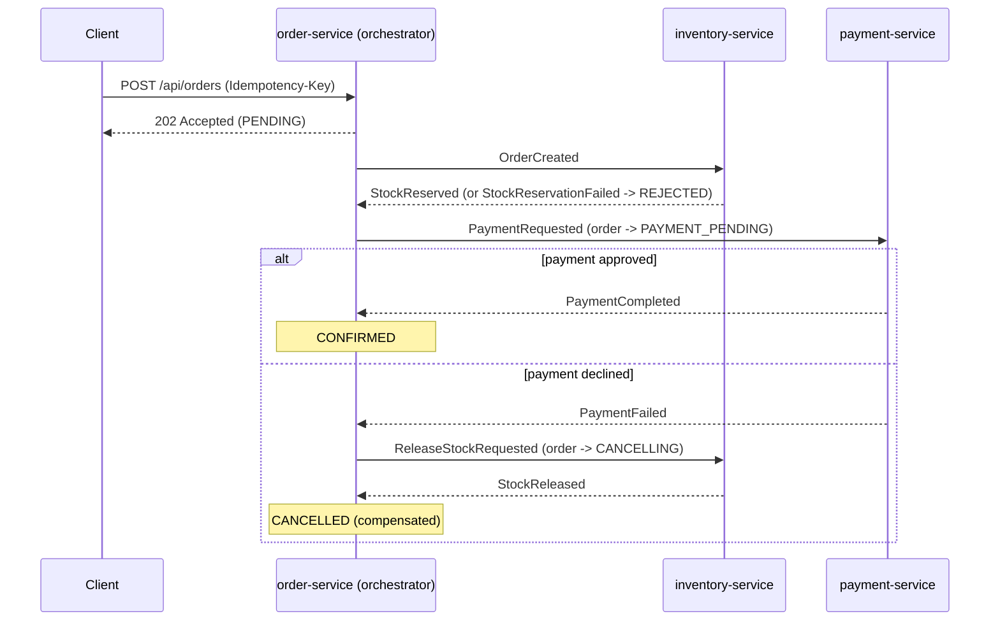
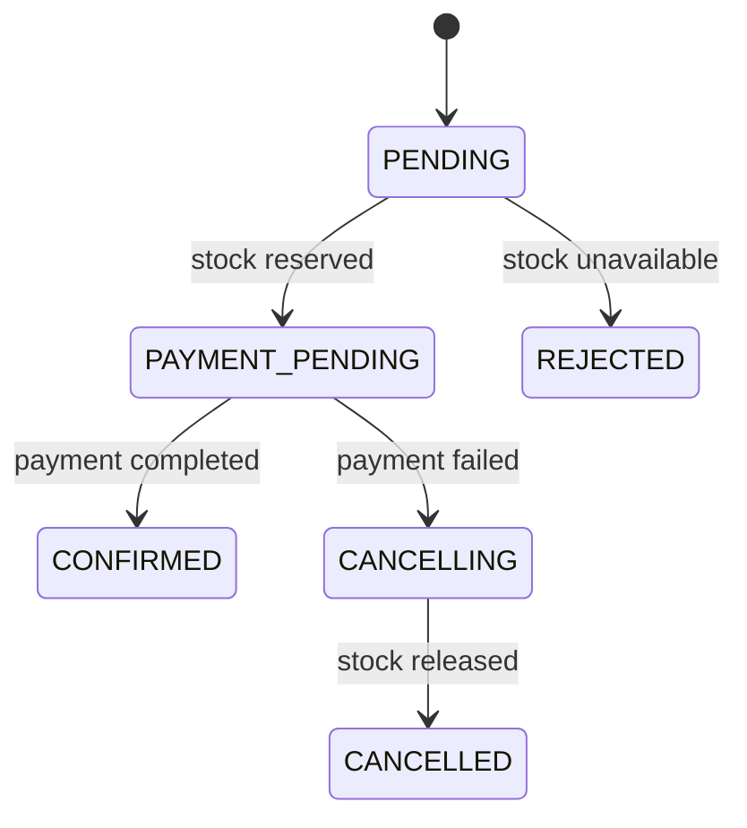

# Event-Driven Order Platform

A Spring Boot 3 / Java 21 microservices backend that demonstrates distributed-consistency patterns:
**transactional outbox**, **idempotent consumers**, **optimistic locking**, **dead-letter topics** and
**Testcontainers-based integration tests**.

## Architecture

An **orchestrated saga**: `order-service` drives the flow, owns the order state, and issues commands; the other
services do one local transaction each and report back. Every hop goes through the transactional outbox.



Order states:



| Module | Responsibility | Port |
|---|---|---|
| `common` | Sealed event contracts, JSON codec, shared Kafka topics and DLT error handling | - |
| `order-service` | Order lifecycle, saga orchestrator, outbox | 8080 |
| `inventory-service` | Stock reservation and release (compensation), idempotent consumer, outbox | 8081 |
| `payment-service` | Mock payment gateway with idempotency keys, idempotent consumer, outbox | 8082 |

## Run it

Requires Docker and (for tests/local builds) JDK 21 + Maven.

```bash
docker compose up --build
```

Try it (stock is seeded: SKU-1001=100, SKU-1002=50, SKU-2001=5):

```bash
# 1. Happy path: PENDING -> PAYMENT_PENDING -> CONFIRMED
curl -s -X POST localhost:8080/api/orders \
  -H 'Content-Type: application/json' -H 'Idempotency-Key: demo-1' \
  -d '{"customerId":"c-1","items":[{"sku":"SKU-1001","quantity":2,"unitPrice":19.99}]}'
curl -s localhost:8080/api/orders/<id>
curl -s localhost:8081/api/inventory/SKU-1001        # available 98, reserved 2
curl -s localhost:8082/api/payments/order/<id>       # COMPLETED

# 2. Payment declined (amounts over 1000 are declined): watch the compensation
curl -s -X POST localhost:8080/api/orders -H 'Content-Type: application/json' \
  -d '{"customerId":"c-1","items":[{"sku":"SKU-1002","quantity":1,"unitPrice":1500.00}]}'
curl -s localhost:8080/api/orders/<id>               # ends CANCELLED, failureReason "Payment failed: Card declined..."
curl -s localhost:8081/api/inventory/SKU-1002        # back to available 50, reserved 0

# 3. Not enough stock: ends REJECTED, payment is never requested
curl -s -X POST localhost:8080/api/orders -H 'Content-Type: application/json' \
  -d '{"customerId":"c-1","items":[{"sku":"SKU-2001","quantity":99,"unitPrice":5.00}]}'
```

Swagger UI: `/swagger-ui.html` on ports 8080, 8081 and 8082.
Metrics: `/actuator/prometheus` on every service. See [Observability](#observability) for dashboards and traces.

## Observability

| What | Where |
|---|---|
| Dashboard (Grafana) | http://localhost:3000, the "Order Platform" dashboard opens by default (edit with `admin` / `admin`) |
| Traces (Jaeger) | http://localhost:16686 |
| Raw metrics (Prometheus) | http://localhost:9090 |

**Follow one order end to end.** Place an order, then in Jaeger choose service `order-service` and operation `POST /api/orders`.
The trace spans order-service, inventory-service and payment-service, including the Kafka hops and the "outbox relay" steps.
Every log line carries the trace id as `[traceId,spanId]`, so you can search the logs for it.

The trace continues across the transactional outbox because each outbox row stores the W3C `traceparent` of the request that
created it (see [ADR 0008](docs/adr/0008-observability.md)).

**Dashboard panels:** orders by saga state, orders per second, API latency (p95/p99), outbox backlog, dead-lettered messages,
saga recovery actions, payment circuit breaker state and call outcomes, Kafka consumer lag, JVM heap.

**Try it:** run the gateway-outage demo from "Failure demos" and watch the breaker flip to `open`, orders pile up in
`PAYMENT_PENDING`, the recovery counters rise, and then the orders drain to `CONFIRMED` or `CANCELLED`.

## Failure demos

Ready-made request bodies live in [`docs/demo`](docs/demo), which avoids shell-quoting problems on Windows
(use `curl.exe`, and `-d @file`). In `docker compose` the saga timeouts are shortened to 15-30 seconds.

```bash
# Happy path / payment declined / no stock
curl.exe -X POST http://localhost:8080/api/orders -H "Content-Type: application/json" -d @docs/demo/order-happy.json
curl.exe -X POST http://localhost:8080/api/orders -H "Content-Type: application/json" -d @docs/demo/order-declined.json
curl.exe -X POST http://localhost:8080/api/orders -H "Content-Type: application/json" -d @docs/demo/order-no-stock.json
```

**Gateway outage: circuit breaker + saga recovery**

```bash
# 1. Break the payment gateway (every call fails with a 503-style error)
curl.exe -X PUT http://localhost:8082/api/admin/gateway -H "Content-Type: application/json" -d @docs/demo/gateway-down.json

# 2. Place an order. It stays PAYMENT_PENDING; payment-service logs "gateway unavailable" and the breaker opens.
curl.exe -X POST http://localhost:8080/api/orders -H "Content-Type: application/json" -d @docs/demo/order-happy.json
curl.exe http://localhost:8082/actuator/circuitbreakers

# 3a. Heal it within ~30 s: the saga re-requests payment and the order becomes CONFIRMED (no double charge)
curl.exe -X PUT http://localhost:8082/api/admin/gateway -H "Content-Type: application/json" -d @docs/demo/gateway-up.json

# 3b. ...or leave it broken: after 3 attempts the order is expired -> CANCELLING -> CANCELLED and stock is released
curl.exe http://localhost:8080/api/orders/<id>
```

Useful while watching: `docker compose logs -f order-service payment-service`, and the metric
`saga_recovery_total` at `http://localhost:8080/actuator/prometheus`.

## Tests

```bash
mvn verify        # needs Docker running (Testcontainers starts PostgreSQL)
```

Highlights:
- `ReservationConcurrencyTest`: 25 concurrent orders for 10 units must produce exactly 10 reservations; stock release is idempotent.
- `OrderServiceIntegrationTest`: every saga path (happy, stock failure, payment failure with compensation) plus duplicate-event safety.
- `PaymentHandlerIntegrationTest`: one charge per order even on redelivery; a gateway outage records nothing and stays retryable.
- `ResilientPaymentGatewayTest`: retries, decline-is-not-a-failure, circuit opens and fails fast, timeout cut-off.
- Saga recovery tests: stuck orders are expired, payment re-requested then cancelled, release re-sent.
- `OrderTest`: the state machine's legal and illegal transitions.

## Design decisions
See [`docs/adr`](docs/adr): outbox, optimistic locking, choreography then orchestrated saga, gateway call outside the transaction, saga timeout recovery, gateway resilience, observability.

## Roadmap
- [x] order + inventory with outbox, idempotent consumers, optimistic locking
- [x] payment-service and orchestrated saga with compensation
- [x] saga timeout sweeper for orders stuck in PAYMENT_PENDING / CANCELLING / PENDING
- [x] Resilience4j (timeout, retry, circuit breaker, bulkhead) around the payment gateway
- [ ] refund compensation for a payment that completes after the order was expired (see ADR 0006)
- [ ] notification-service
- [ ] api-gateway (Spring Cloud Gateway) + Keycloak OAuth2/JWT + rate limiting (Redis)
- [x] OpenTelemetry tracing across Kafka hops, Prometheus + Grafana dashboards
- [ ] Pact contract tests between services
- [ ] k6 load test with results published here
- [ ] Kubernetes manifests / Helm chart
