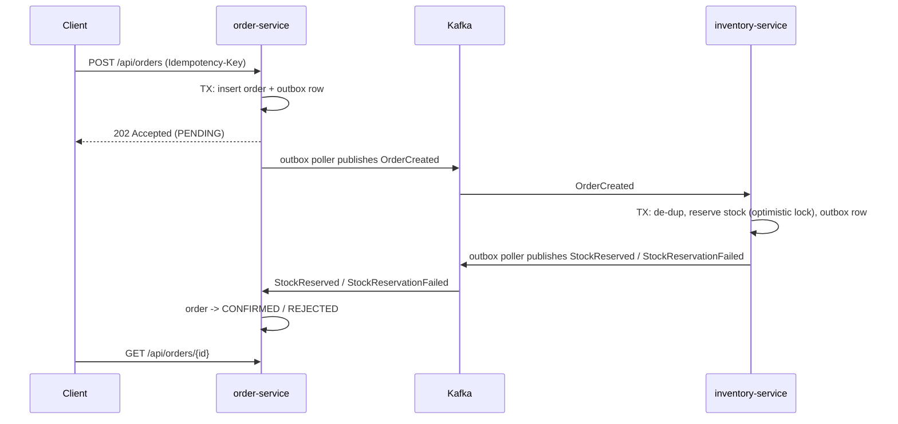

# Event-Driven Order Platform

A Spring Boot 3 / Java 21 microservices backend that demonstrates distributed-consistency patterns:
**transactional outbox**, **idempotent consumers**, **optimistic locking**, **dead-letter topics** and
**Testcontainers-based integration tests**.

## Architecture



| Module | Responsibility | Port |
|---|---|---|
| `common` | Sealed event contracts, JSON codec, shared Kafka topics and DLT error handling | - |
| `order-service` | Order lifecycle, outbox, consumes inventory events | 8080 |
| `inventory-service` | Stock reservation, idempotent consumer, outbox | 8081 |

## Run it

Requires Docker and (for tests/local builds) JDK 21 + Maven.

```bash
docker compose up --build
```

Try it:

```bash
# Place an order (stock is seeded: SKU-1001=100, SKU-1002=50, SKU-2001=5)
curl -s -X POST localhost:8080/api/orders \
  -H 'Content-Type: application/json' -H 'Idempotency-Key: demo-1' \
  -d '{"customerId":"c-1","items":[{"sku":"SKU-1001","quantity":2,"unitPrice":19.99}]}'

# Poll the order: PENDING -> CONFIRMED
curl -s localhost:8080/api/orders/<id>

# Stock was decremented
curl -s localhost:8081/api/inventory/SKU-1001

# Ask for more than exists: order ends REJECTED with a reason
curl -s -X POST localhost:8080/api/orders -H 'Content-Type: application/json' \
  -d '{"customerId":"c-1","items":[{"sku":"SKU-2001","quantity":99,"unitPrice":5.00}]}'
```

Swagger UI: http://localhost:8080/swagger-ui.html and http://localhost:8081/swagger-ui.html
Metrics: `/actuator/prometheus` on both services.

## Tests

```bash
mvn verify        # needs Docker running (Testcontainers starts PostgreSQL)
```

Highlights:
- `ReservationConcurrencyTest`: 25 concurrent orders for 10 units must produce exactly 10 reservations.
- Duplicate Kafka delivery is processed once; a multi-line order is all-or-nothing.
- `OrderServiceIntegrationTest`: order + outbox row commit atomically; idempotency keys; duplicate events are harmless.

## Design decisions
See [`docs/adr`](docs/adr): outbox, optimistic locking, choreography vs orchestration.

## Roadmap
- [ ] payment-service with simulated failures; saga with compensation (release stock)
- [ ] notification-service
- [ ] api-gateway (Spring Cloud Gateway) + Keycloak OAuth2/JWT + rate limiting (Redis)
- [ ] Resilience4j (circuit breaker, retry, bulkhead) on outbound calls
- [ ] OpenTelemetry tracing across Kafka hops, Prometheus + Grafana dashboards
- [ ] Pact contract tests between services
- [ ] k6 load test with results published here
- [ ] Kubernetes manifests / Helm chart
