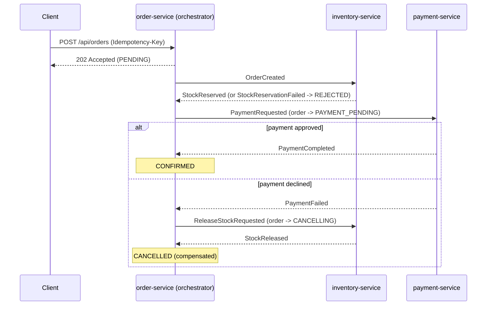
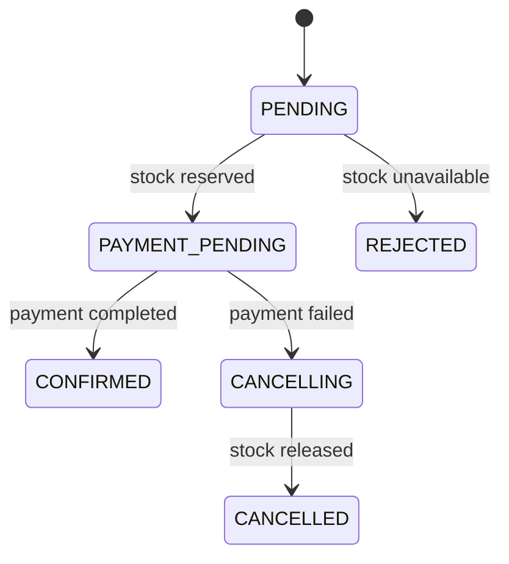

# Event-Driven Order Platform

A Spring Boot 3 / Java 21 microservices backend that demonstrates distributed-consistency patterns:
**transactional outbox**, **idempotent consumers**, **optimistic locking**, **dead-letter topics** and
**Testcontainers-based integration tests**.

## Architecture

An **orchestrated saga**: `order-service` drives the flow, owns the order state, and issues commands; the other
services do one local transaction each and report back. Every hop goes through the transactional outbox.



Order states:



| Module | Responsibility | Port |
|---|---|---|
| `common` | Sealed event contracts, JSON codec, shared Kafka topics and DLT error handling | - |
| `order-service` | Order lifecycle, saga orchestrator, outbox | 8080 |
| `inventory-service` | Stock reservation and release (compensation), idempotent consumer, outbox | 8081 |
| `payment-service` | Mock payment gateway with idempotency keys, idempotent consumer, outbox | 8082 |

## Run it

Requires Docker and (for tests/local builds) JDK 21 + Maven.

```bash
docker compose up --build
```

Try it (stock is seeded: SKU-1001=100, SKU-1002=50, SKU-2001=5):

```bash
# 1. Happy path: PENDING -> PAYMENT_PENDING -> CONFIRMED
curl -s -X POST localhost:8080/api/orders \
  -H 'Content-Type: application/json' -H 'Idempotency-Key: demo-1' \
  -d '{"customerId":"c-1","items":[{"sku":"SKU-1001","quantity":2,"unitPrice":19.99}]}'
curl -s localhost:8080/api/orders/<id>
curl -s localhost:8081/api/inventory/SKU-1001        # available 98, reserved 2
curl -s localhost:8082/api/payments/order/<id>       # COMPLETED

# 2. Payment declined (amounts over 1000 are declined): watch the compensation
curl -s -X POST localhost:8080/api/orders -H 'Content-Type: application/json' \
  -d '{"customerId":"c-1","items":[{"sku":"SKU-1002","quantity":1,"unitPrice":1500.00}]}'
curl -s localhost:8080/api/orders/<id>               # ends CANCELLED, failureReason "Payment failed: Card declined..."
curl -s localhost:8081/api/inventory/SKU-1002        # back to available 50, reserved 0

# 3. Not enough stock: ends REJECTED, payment is never requested
curl -s -X POST localhost:8080/api/orders -H 'Content-Type: application/json' \
  -d '{"customerId":"c-1","items":[{"sku":"SKU-2001","quantity":99,"unitPrice":5.00}]}'
```

Swagger UI: `/swagger-ui.html` on ports 8080, 8081 and 8082.
Metrics: `/actuator/prometheus` on every service.

## Tests

```bash
mvn verify        # needs Docker running (Testcontainers starts PostgreSQL)
```

Highlights:
- `ReservationConcurrencyTest`: 25 concurrent orders for 10 units must produce exactly 10 reservations; stock release is idempotent.
- `OrderServiceIntegrationTest`: every saga path (happy, stock failure, payment failure with compensation) plus duplicate-event safety.
- `PaymentHandlerIntegrationTest` / `MockPaymentGatewayTest`: one charge per order even on redelivery.
- `OrderTest`: the state machine's legal and illegal transitions.

## Design decisions
See [`docs/adr`](docs/adr): outbox, optimistic locking, choreography then orchestrated saga, gateway call outside the transaction.

## Roadmap
- [x] order + inventory with outbox, idempotent consumers, optimistic locking
- [x] payment-service and orchestrated saga with compensation
- [ ] saga timeout sweeper for orders stuck in PAYMENT_PENDING / CANCELLING
- [ ] Resilience4j (timeout, retry, circuit breaker) around the payment gateway
- [ ] notification-service
- [ ] api-gateway (Spring Cloud Gateway) + Keycloak OAuth2/JWT + rate limiting (Redis)
- [ ] OpenTelemetry tracing across Kafka hops, Prometheus + Grafana dashboards
- [ ] Pact contract tests between services
- [ ] k6 load test with results published here
- [ ] Kubernetes manifests / Helm chart
