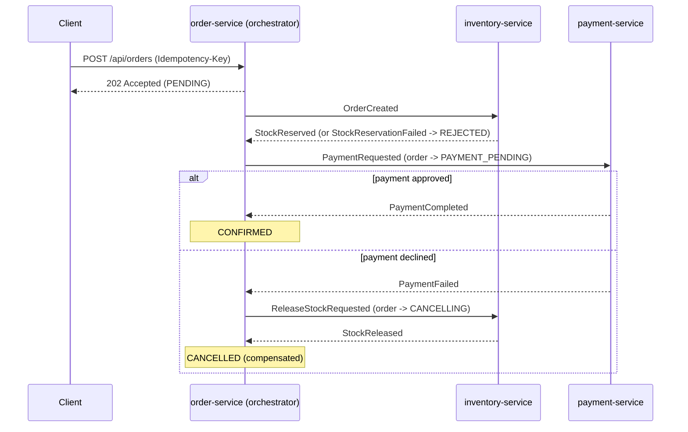
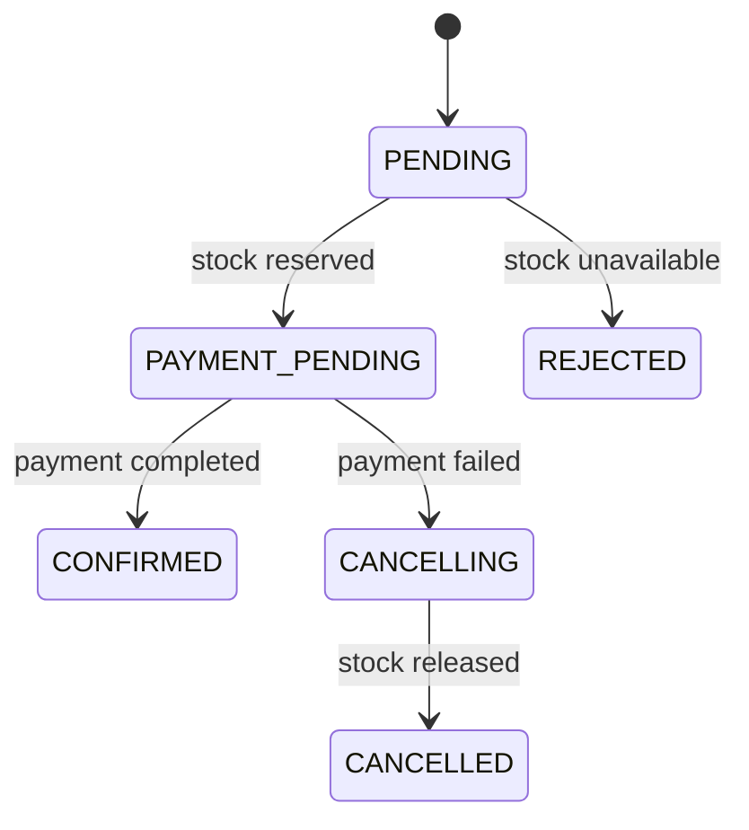

# Event-Driven Order Platform

[](https://github.com/your-github-username/order-platform/actions/workflows/ci.yml)

A Spring Boot 3 / Java 21 microservices backend that demonstrates distributed-consistency patterns:
**transactional outbox**, **idempotent consumers**, **optimistic locking**, **dead-letter topics** and
**Testcontainers-based integration tests**.

## Architecture

An **orchestrated saga**: `order-service` drives the flow, owns the order state, and issues commands; the other
services do one local transaction each and report back. Every hop goes through the transactional outbox.



Order states:



| Module | Responsibility | Port |
|---|---|---|
| `common` | Sealed event contracts, JSON codec, shared Kafka topics and DLT error handling | - |
| `order-service` | Order lifecycle, saga orchestrator, outbox | 8080 |
| `inventory-service` | Stock reservation and release (compensation), idempotent consumer, outbox | 8081 |
| `payment-service` | Mock payment gateway with idempotency keys, idempotent consumer, outbox | 8082 |

## Quick start

Requires Docker (Compose v2) with **at least 6 GB of memory** allocated to it. Pick one option.

### Option A: prebuilt images (about a minute)

CI publishes the images to GitHub Container Registry after every green build on `main`.

```bash
git clone https://github.com/your-github-username/order-platform.git
cd order-platform
docker compose pull
docker compose up --no-build -d
```

### Option B: build from source (first build takes several minutes)

```bash
docker compose up --build -d
```

Only Docker is needed: Maven and the JDK run inside the build.

### Option C: GitHub Codespaces (nothing to install)

**Code, then Codespaces, then Create codespace on main**, choosing a 4-core / 16 GB machine. In its terminal run Option A.
Forwarded ports (Grafana, Jaeger, APIs) are listed in the Ports tab.

### Run the demo

```powershell
# Windows PowerShell
powershell -ExecutionPolicy Bypass -File scripts/demo.ps1
```
```bash
# macOS / Linux / Codespaces
./scripts/demo.sh
```

The script waits for the services, runs the scenarios below, and prints PASS or FAIL for each.
Run one scenario with `-Scenario happy|declined|nostock|outage` (PowerShell) or `./scripts/demo.sh outage` (bash).
For a talk track and likely interview questions see [`docs/DEMO.md`](docs/DEMO.md).

| Scenario | What it shows | Final status |
|---|---|---|
| `happy` | Stock reserved, payment approved | `CONFIRMED` |
| `declined` | Payment declined, reserved stock is released (compensation) | `CANCELLED` |
| `nostock` | Not enough stock, payment never requested | `REJECTED` |
| `outage` | Payment gateway fails, circuit breaker opens, saga recovers when it heals | `CONFIRMED` |

| What | Where |
|---|---|
| order-service / inventory-service / payment-service APIs | http://localhost:8080, :8081, :8082 (Swagger UI at `/swagger-ui.html`) |
| Grafana dashboard | http://localhost:3000 |
| Jaeger traces | http://localhost:16686 |
| Prometheus | http://localhost:9090 |

Stop and clear everything with `docker compose down -v`.
If you forked this repo, set `IMAGE_PREFIX` in [`.env`](.env) to `ghcr.io/<your-username>`.

<!-- Screenshots: add images to docs/images and uncomment.


-->

## Observability

| What | Where |
|---|---|
| Dashboard (Grafana) | http://localhost:3000, the "Order Platform" dashboard opens by default (edit with `admin` / `admin`) |
| Traces (Jaeger) | http://localhost:16686 |
| Raw metrics (Prometheus) | http://localhost:9090 |

**Follow one order end to end.** Place an order, then in Jaeger choose service `order-service` and operation `POST /api/orders`.
The trace spans order-service, inventory-service and payment-service, including the Kafka hops and the "outbox relay" steps.
Every log line carries the trace id as `[traceId,spanId]`, so you can search the logs for it.

The trace continues across the transactional outbox because each outbox row stores the W3C `traceparent` of the request that
created it (see [ADR 0008](docs/adr/0008-observability.md)).

**Dashboard panels:** orders by saga state, orders per second, API latency (p95/p99), outbox backlog, dead-lettered messages,
saga recovery actions, payment circuit breaker state and call outcomes, Kafka consumer lag, JVM heap.

**Try it:** run the gateway-outage demo from "Failure demos" and watch the breaker flip to `open`, orders pile up in
`PAYMENT_PENDING`, the recovery counters rise, and then the orders drain to `CONFIRMED` or `CANCELLED`.

## Failure demos

`scripts/demo.ps1` / `scripts/demo.sh` automate all of this. The manual commands are kept here for reference.

Ready-made request bodies live in [`docs/demo`](docs/demo), which avoids shell-quoting problems on Windows
(use `curl.exe`, and `-d @file`). In `docker compose` the saga timeouts are shortened to 15-30 seconds.

```bash
# Happy path / payment declined / no stock
curl.exe -X POST http://localhost:8080/api/orders -H "Content-Type: application/json" -d @docs/demo/order-happy.json
curl.exe -X POST http://localhost:8080/api/orders -H "Content-Type: application/json" -d @docs/demo/order-declined.json
curl.exe -X POST http://localhost:8080/api/orders -H "Content-Type: application/json" -d @docs/demo/order-no-stock.json
```

**Gateway outage: circuit breaker + saga recovery**

```bash
# 1. Break the payment gateway (every call fails with a 503-style error)
curl.exe -X PUT http://localhost:8082/api/admin/gateway -H "Content-Type: application/json" -d @docs/demo/gateway-down.json

# 2. Place an order. It stays PAYMENT_PENDING; payment-service logs "gateway unavailable" and the breaker opens.
curl.exe -X POST http://localhost:8080/api/orders -H "Content-Type: application/json" -d @docs/demo/order-happy.json
curl.exe http://localhost:8082/actuator/circuitbreakers

# 3a. Heal it within ~30 s: the saga re-requests payment and the order becomes CONFIRMED (no double charge)
curl.exe -X PUT http://localhost:8082/api/admin/gateway -H "Content-Type: application/json" -d @docs/demo/gateway-up.json

# 3b. ...or leave it broken: after 3 attempts the order is expired -> CANCELLING -> CANCELLED and stock is released
curl.exe http://localhost:8080/api/orders/<id>
```

Useful while watching: `docker compose logs -f order-service payment-service`, and the metric
`saga_recovery_total` at `http://localhost:8080/actuator/prometheus`.

## Tests

```bash
mvn verify        # needs Docker running (Testcontainers starts PostgreSQL)
```

Highlights:
- `ReservationConcurrencyTest`: 25 concurrent orders for 10 units must produce exactly 10 reservations; stock release is idempotent.
- `OrderServiceIntegrationTest`: every saga path (happy, stock failure, payment failure with compensation) plus duplicate-event safety.
- `PaymentHandlerIntegrationTest`: one charge per order even on redelivery; a gateway outage records nothing and stays retryable.
- `ResilientPaymentGatewayTest`: retries, decline-is-not-a-failure, circuit opens and fails fast, timeout cut-off.
- Saga recovery tests: stuck orders are expired, payment re-requested then cancelled, release re-sent.
- `OrderTest`: the state machine's legal and illegal transitions.

## Design decisions
See [`docs/adr`](docs/adr): outbox, optimistic locking, choreography then orchestrated saga, gateway call outside the transaction, saga timeout recovery, gateway resilience, observability.

## Known limitations

Stated up front, because they are real design trade-offs rather than oversights:

- A payment that completes at the moment its order times out leaves a charged but cancelled order. The fix is a refund compensation (see ADR 0006).
- No authentication: the APIs and the demo-only `/api/admin/gateway` endpoint are open. A gateway with OAuth2/JWT is on the roadmap.
- The payment gateway is a mock. It simulates idempotency keys, declines and outages, but is not a real provider.
- One Kafka broker and one PostgreSQL instance per service; Jaeger keeps traces in memory only.
- Commands re-sent by the timeout sweeper start a new trace rather than continuing the order's original trace.
- The outbox and processed-message tables are never pruned.
- No load test results yet.

## Roadmap
- [x] order + inventory with outbox, idempotent consumers, optimistic locking
- [x] payment-service and orchestrated saga with compensation
- [x] saga timeout sweeper for orders stuck in PAYMENT_PENDING / CANCELLING / PENDING
- [x] Resilience4j (timeout, retry, circuit breaker, bulkhead) around the payment gateway
- [ ] refund compensation for a payment that completes after the order was expired (see ADR 0006)
- [ ] notification-service
- [ ] api-gateway (Spring Cloud Gateway) + Keycloak OAuth2/JWT + rate limiting (Redis)
- [x] OpenTelemetry tracing across Kafka hops, Prometheus + Grafana dashboards
- [ ] Pact contract tests between services
- [ ] k6 load test with results published here
- [ ] Kubernetes manifests / Helm chart
